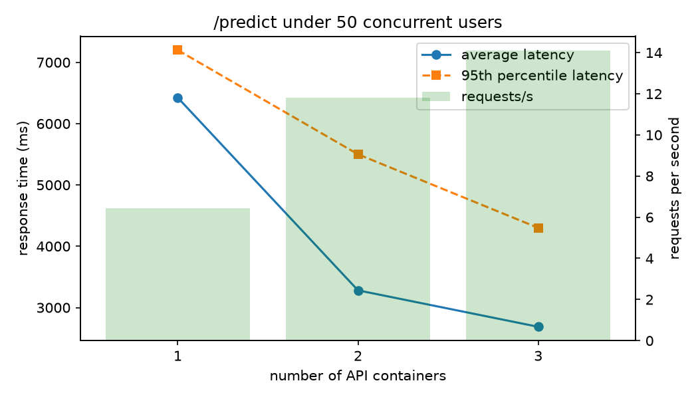

# 🌿 Cassava Leaf Doctor: Machine Learning Cycle

An end-to-end machine learning pipeline that classifies **cassava leaf photos** into five classes, served as a web app
that can predict, show data insights, accept new labelled images and **retrain itself**.

| | |
|---|---|
| 🎥 **Video demo** | TODO: YouTube link |
| 🌐 **Live app** | TODO: `https://<your-hf-username>-cassava-leaf-doctor.hf.space` |
| 📘 **API docs (Swagger UI)** | TODO: live app URL + `/docs` |
| 📓 **Notebook** | [`notebook/summative_cassava_mlops.ipynb`](notebook/summative_cassava_mlops.ipynb) |

---

## 1. Project description

Cassava feeds hundreds of millions of people across Africa, and viral and bacterial diseases can wipe out a
smallholder's harvest. Diagnosing a leaf usually needs an agricultural expert. This project lets a farmer or
extension officer take a photo and get a diagnosis in under a second:

| Class | Disease |
|---|---|
| CBB | Cassava Bacterial Blight |
| CBSD | Cassava Brown Streak Disease |
| CGM | Cassava Green Mottle |
| CMD | Cassava Mosaic Disease |
| Healthy | Healthy leaf |

It builds on our Intro to ML summative (same problem, same Kaggle dataset of 21,397 photos). The summative's best
model, a **frozen MobileNetV2 with a small trained head and softened class weights** (experiment E11), is the model
used here. This project adds everything needed to run it in production: an API, a UI, a database, a retraining
pipeline with an automatic trigger, Docker, cloud deployment and load testing.

## 2. Features

| Requirement | Where |
|---|---|
| Predict one image | UI **Predict** tab, or `POST /predict` |
| Data visualisations with interpretations (class balance + 4 image features) | UI **Data insights** tab, notebook section 4 |
| Bulk upload (many images, or a .zip of class folders), saved to a database | UI **Upload & retrain** tab, `POST /upload` |
| Retraining: manual button + automatic trigger | `POST /retrain`, and automatically after 25 new images |
| Model up-time and monitoring | UI **Model status** tab, `GET /health` |
| Model evaluation with 6 metrics | notebook sections 8 and 9, UI **Model status** tab |
| Load test with 1, 2 and 3 Docker containers | `locustfile.py`, `scripts/run_load_tests.py` |

## 3. How it works

```
             ┌──────────────────── offline (Google Colab, GPU) ───────────────────┐
 Kaggle API ─► checks ─► split 70/15/15 ─► resize 224 ─► MobileNetV2 (frozen) ─► train head ─► evaluate ─► model v1
             └────────────────────────────────────────────────────────────────────┘
                                                                                          │
             ┌──────────────────── online (Docker container) ───────────────────┐         ▼
 Browser ──► FastAPI ──► /predict  ──► Predictor (reloads automatically when a new version is saved)
                    ├──► /upload   ──► validate + save image ──► SQLite (uploads table)
                    │                                              │ 25 waiting images = auto trigger
                    └──► /retrain  ──► load CURRENT model ──► features ──► fine tune head ──► compare on test set
                                                                         ──► promote new version (old one archived)
```

**Model:** `image 224×224 → Rescaling(-1..1) → MobileNetV2 (ImageNet weights, frozen) → GlobalAveragePooling
(1,280 features) → Dense 256 ReLU + L2 → Dropout 0.3 → Dense 5 softmax`

**Optimisation:** pretrained model (transfer learning), Adam, L2 regularisation, dropout, early stopping,
ReduceLROnPlateau, softened class weights for the imbalanced classes.

**Retraining** (`src/retrain.py`), the same steps whether started by the button or the automatic trigger:
1. **Upload and save:** every uploaded image is validated, re-saved as a clean JPEG and recorded in the `uploads`
   table of the SQLite database (`data/cassava.db`).
2. **Preprocess:** the new images plus a "replay" sample of 30 old images per class (so the model does not forget)
   are resized and turned into MobileNetV2 features.
3. **Retrain from the pretrained model:** the **current production model is loaded** and its head is fine tuned
   with a small learning rate (1e-4), early stopping and class weights. Nothing is trained from scratch.
4. **Evaluate and promote:** old and new model are scored on the same fixed test set. The new version replaces the
   old one unless its macro F1 drops by more than 0.02. Every run is logged in the `training_runs` table and shown
   in the UI.

## 4. Repository structure

```
cassava-mlops/
├── README.md
├── notebook/
│   └── summative_cassava_mlops.ipynb      acquisition, preprocessing, training, evaluation, retraining demo
├── src/
│   ├── preprocessing.py         image loading, validation, resizing, image features
│   ├── model.py                 build, train, evaluate (6 metrics), save/load with versioning
│   ├── prediction.py            predict one image (used by the API)
│   ├── retrain.py               retraining pipeline + automatic trigger
│   ├── database.py              SQLite: uploads, training runs, predictions
│   ├── insights.py              numbers and interpretations for the visualisations
│   └── config.py                paths and settings
├── api/main.py                  FastAPI app (all endpoints)
├── ui/index.html                web UI
├── data/
│   ├── train/<class>/           sample of training images (retraining replays these)
│   └── test/<class>/            fixed balanced test sample (40 per class)
├── models/
│   ├── cassava_mobilenetv2.keras    the production model
│   └── model_metadata.json          version, metrics, history
├── Dockerfile, docker-compose.yml, nginx.conf
├── locustfile.py, scripts/run_load_tests.py
├── scripts/deploy_hf.py         deploy to Hugging Face Spaces
└── results/locust/              load test results
```

## 5. Setup

### Step 1: Train the model in Colab (once)
1. Open `notebook/summative_cassava_mlops.ipynb` in Google Colab and choose a **T4 GPU** runtime.
2. In the first code cell, set `REPO_URL` to this repository's URL.
3. Add your Kaggle API token as a Colab secret named `KAGGLE_API_TOKEN` (key icon on the left sidebar).
   You must also have joined the [competition](https://www.kaggle.com/competitions/cassava-leaf-disease-classification).
4. **Runtime > Run all** (about 15 minutes). The last cell downloads `deploy_artifacts.zip`.
5. Unzip it into the repo folder (it fills `models/`, `data/train/`, `data/test/`, `notebook/figures/`), then commit
   and push.

### Step 2: Run locally

**With Python** (Python 3.10 to 3.13):
```bash
python -m venv .venv
.venv\Scripts\activate            # Windows   (macOS/Linux: source .venv/bin/activate)
pip install -r requirements-dev.txt
uvicorn api.main:app --port 8000
```
Open http://localhost:8000 (UI) or http://localhost:8000/docs (Swagger UI).

**With Docker** (Docker Desktop running):
```bash
docker compose up -d --build      # app + nginx load balancer
```
Open http://localhost:8080. Stop with `docker compose down` (add `-v` to also wipe uploads and retrained models).

### Step 3: Deploy to the cloud (Hugging Face Spaces, free)
```bash
pip install huggingface_hub
python scripts/deploy_hf.py --space YOUR_HF_USERNAME/cassava-leaf-doctor --token hf_YOUR_WRITE_TOKEN
```
The Space builds the Dockerfile (5 to 10 minutes) and serves the app at
`https://YOUR_HF_USERNAME-cassava-leaf-doctor.hf.space`. Free Spaces give 2 CPUs and 16 GB of RAM, which is
enough for TensorFlow and for retraining. Note: a free Space restarts after inactivity and its disk resets, so
uploads and retrained versions last until the next restart.

## 6. Using the app

* **Predict:** upload a leaf photo, or click one of the test images. Test images show the true class next to the
  prediction, so you can see whether it is correct.
* **Data insights:** class balance plus brightness, greenness, yellow/brown share and contrast per class, each
  with an interpretation computed from the data.
* **Upload & retrain:** pick a class and several images, or upload a .zip with `CBB/`, `CBSD/`, `CGM/`, `CMD/`,
  `Healthy/` folders. Press **Retrain model**, or upload 25 images and it starts by itself. Progress and the
  before/after scores appear on the page.
* **Model status:** up-time, model version, test metrics, per-class recall and the version history.

Command line equivalents:
```bash
python -m src.prediction path/to/leaf.jpg       # predict one image
python -m src.retrain                           # retrain on all pending uploads
```

### API endpoints
| Method | Path | Purpose |
|---|---|---|
| GET | `/health` | up-time, model version, requests served, container name |
| GET | `/model` | model version, test metrics, version history |
| POST | `/predict` | form field `file`: one image → class, confidence, all probabilities |
| POST | `/upload` | form fields `files` (images or .zip) and optional `label` |
| POST | `/retrain` | start a retraining run |
| GET | `/retrain/status` | progress, waiting uploads, past runs |
| GET | `/insights` | data for the visualisations |
| GET | `/samples` | test images with known labels |

## 7. Model results

Results from the notebook (held-out test set of 3,210 images, imbalanced like the real data):

| Metric | Value |
|---|---|
| Accuracy | 0.7299 |
| Loss (cross-entropy) | 0.7434 |
| Precision (macro) | 0.5789 |
| Recall (macro) | 0.5703 |
| F1 (macro) | 0.5730 |
| F1 (weighted) | 0.7289 |
| AUC (macro, one-vs-rest) | 0.8959 |

For reference, the summative's E11 model reached accuracy 0.728, macro F1 0.571 and macro AUC 0.896 on its test set.
The app's **Model status** page shows scores on the smaller, *balanced* test sample in `data/test`, so its
accuracy is lower than the table above; macro F1 is the fairer number to compare.

## 8. Flood request simulation (Locust)

Each simulated user sends a random test image to `POST /predict` every 0.2 to 1 seconds (plus an occasional
`GET /health`). The same load is run against 1, 2 and 3 API containers behind nginx, each container limited to
1 CPU:

```bash
pip install -r requirements-dev.txt
python scripts/run_load_tests.py --users 50 --duration 60s
```

TODO: paste the table from `results/locust/summary.md` here.

| Containers | Users | Requests | Failures | Avg (ms) | Median (ms) | 95th pct (ms) | Requests/s |
|---|---|---|---|---|---|---|---|
| 1 | 50 | | | | | | |
| 2 | 50 | | | | | | |
| 3 | 50 | | | | | | |



**How to read it:** with one container, requests queue up behind each other, so response time grows with the
number of users. Each extra container adds another CPU working in parallel, so the average and 95th percentile
response times should fall and requests per second should rise. TODO: describe what your numbers show.

To watch a test live, run `locust -f locustfile.py --host http://localhost:8080` and open http://localhost:8089.

## 9. Limitations

* The classes are imbalanced (CMD about 61%), and CGM, CBSD and Healthy leaves are still confused with CMD.
* The deployed app keeps a sample of training images, not all 21,397, so retraining fine tunes the head on new
  uploads plus that sample.
* On free hosting, uploads and retrained models are lost when the Space restarts. A production system would keep
  them in cloud storage.
